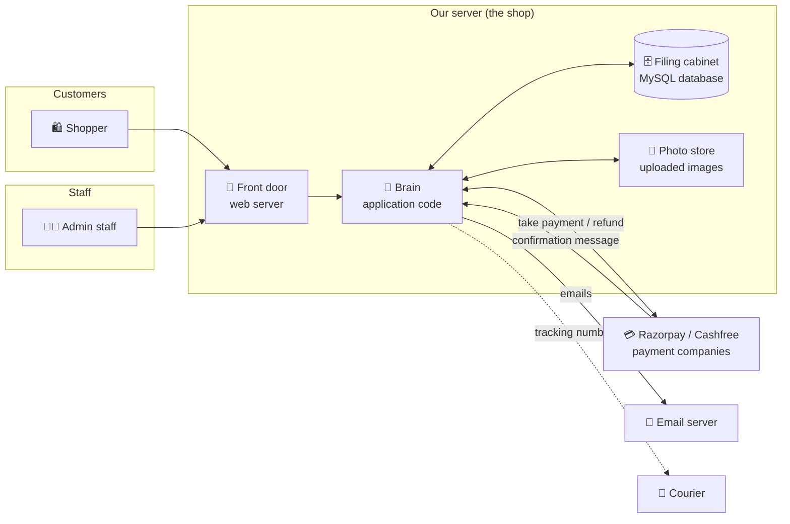
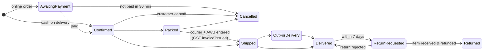
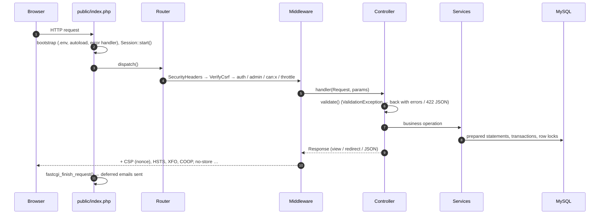
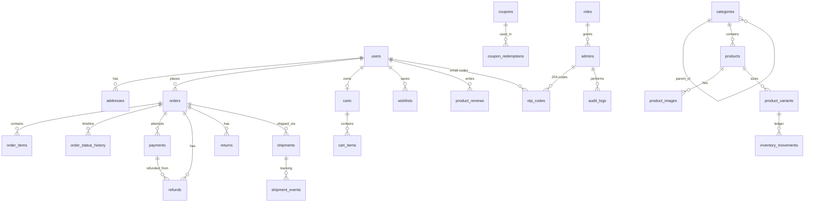

# Jersey Musium — How the Application Works

> **Who this is for:** everyone involved with the store.
> **Part A** explains the whole application in plain language, with no programming knowledge needed: owners, operations staff, marketers, accountants and auditors.
> **Part B** is the technical reference for developers and DevOps.
> Diagrams are drawn with Mermaid. They render automatically on GitHub, GitLab and in VS Code (with a Mermaid extension).
> Companion documents: [SECURITY_AUDIT.md](SECURITY_AUDIT.md) (security review and test evidence) and [README.md](../README.md) (quick start).

---

# PART A — The application in plain language

## A1. What is Jersey Musium?

Jersey Musium is an **online shop for football jerseys**, built like the big Indian fashion apps (Myntra, Flipkart). It has two faces:

| | Who uses it | Address | What they do |
|---|---|---|---|
| **The Store** | Shoppers, on phone or computer | `www.yourdomain.com` | Browse jerseys, filter by team/size/price, add their name & number to a shirt, pay (UPI, card, net banking, wallet or cash on delivery), track delivery, return items |
| **The Admin Console** | Your staff | `www.yourdomain.com/admin` | Add products, run offers, pack & ship orders, handle returns and refunds, manage customers and staff, change store settings |

When someone opens the home page for the first time in a visit, a short **"kick-off" intro animation** plays: two players run in and strike the ball together, and the ball flies at the screen to reveal the shop. It can be skipped, and turned off in settings.

## A2. The big picture

Think of the application as a **shop building**:



* **Front door (web server):** receives every visit and passes it to the brain.
* **Brain (application):** applies the shop's rules, such as prices, stock, offers, who may do what, and what happens after payment.
* **Filing cabinet (database):** keeps every product, customer, order, payment, refund and invoice.
* **Payment companies:** Razorpay and Cashfree handle card and UPI details. **Your server never sees or stores card numbers.**
* **Email server:** sends order confirmations, shipping updates, password resets and admin sign-in codes.

## A3. What happens when someone buys a jersey

```mermaid
sequenceDiagram
    autonumber
    actor S as Shopper
    participant St as Store
    participant P as Razorpay / Cashfree
    actor A as Admin staff
    S->>St: Signs up – a 6-digit code is emailed; enters it to verify the email
    S->>St: Browses, picks size, adds name & number
    S->>St: Applies coupon, enters address, chooses payment
    St->>St: Re-checks prices & stock, RESERVES the jersey
    alt Online payment
        St->>P: "Please collect ₹1,499"
        S->>P: Pays with UPI / card (on the payment company's secure window)
        P-->>St: "Paid" (checked twice: browser + secure server message)
    else Cash on Delivery
        St->>St: Order confirmed immediately (cash collected later)
    end
    St-->>S: "Order confirmed" page + email
    A->>St: Packs the order, enters courier & tracking number
    St->>St: Issues GST invoice number (JM/26-27/000123)
    St-->>S: "Shipped" email with tracking + invoice link
    A->>St: Marks "out for delivery" → "delivered"
    St-->>S: "Delivered" email
```

**Important safeguards, in plain words**
* **Every new account must verify its email** with a 6-digit code before it can order, review or return. This stops fake or mistyped addresses.
* **Prices are always recalculated by the server.** A shopper cannot change the price in their browser.
* **Stock is reserved** the moment the order is placed, so two people can never buy the last shirt.
* **Unpaid orders expire.** If an online payment isn't completed within 30 minutes, the order cancels itself and the stock goes back on sale.
* **Payments are confirmed twice:** once by the shopper's browser and once by a signed message straight from the payment company. If the shopper closes the tab after paying, the order still gets confirmed.
* If money somehow arrives for an order that already expired, the system **refunds it automatically**.

## A4. The life of an order



| Status | Meaning | Who moves it |
|---|---|---|
| Awaiting payment | Order created; shopper is on the payment screen | Automatic |
| Confirmed | Paid (or COD); ready for the warehouse | Automatic |
| Packed | Packed and waiting for courier pickup | Staff |
| Shipped | Handed to the courier; tracking number saved; **invoice issued** | Staff (Create shipment) |
| Out for delivery / Delivered | Courier progress | Staff (tracking updates) |
| Cancelled | Stock returned; refund started automatically if prepaid | Customer (before packing) or staff |
| Return requested / Returned | Customer asked to return; item received and refunded | Customer, then staff |

## A5. Money: payments, refunds and invoices

* **Payment options:**
  * Razorpay or Cashfree: UPI, cards, net banking, wallets, EMI.
  * **Cash on Delivery**, with a small handling fee and a maximum order value, both set in Settings.
* **Refunds:**
  * Online orders are refunded **to the original payment method** through the payment company (5–7 working days for the customer).
  * Cash-on-delivery orders are refunded by your team to the customer's **UPI ID**. Staff record the transfer reference (UTR).
  * The system **never allows refunding more than was paid**.
* **GST invoices:** issued when the order ships. Each one has:
  * a consecutive number for the financial year (e.g. `JM/26-27/000042`)
  * your GSTIN, HSN codes and the place of supply
  * a CGST + SGST split (same state) or IGST (different state)
  * the amount in words

  Prices shown to shoppers already **include GST**. The invoice works out the tax portion. Customers can download their invoice from *My Orders*.

## A6. The admin console: who can do what

Staff sign in at `/admin` with **email + password + a 6-digit code emailed to them**. Each staff member has a **role**:

| Role | Can do |
|---|---|
| **Super Admin** (owner) | Everything, including adding staff and changing settings |
| **Store Manager** | Everything except managing staff and viewing the audit log |
| **Order Operations** | Orders, shipping, returns, customers, view payments |
| **Catalog & Marketing** | Products, categories, offer banners, promo codes, pages, reviews |
| **Finance** | Payments, refunds, orders (view) |

You can create your own roles by ticking permissions. Some protections are always on:
* Nobody except a Super Admin can create Super Admins.
* Nobody can widen their own permissions.
* The store can never lose its last Super Admin.

**Every admin action is recorded** in the Audit Log: who did it, when, and from which internet address.

### Daily operations guide

| Task | Where | Steps |
|---|---|---|
| **Add a new jersey** | Products → Add product | Name → category → team/league/season → price & MRP → sizes with stock → upload photos (first = main, second = hover) → SEO text → Save |
| **Process new orders** | Orders → "New" tab | Open order → *Update status: Packed* → *Create shipment* (courier + AWB + tracking link) → customer is emailed automatically |
| **Update delivery** | Order page → shipment box | Choose *Out for delivery* / *Delivered* → Add update |
| **Cancel an order** | Order page → Cancel order | Enter reason → stock is restored; if prepaid, the refund starts automatically |
| **Handle a return** | Returns | Approve → Picked up → Received (stock added back) → Refund |
| **Give a partial refund** | Order page → Issue refund | Amount + reason (COD: enter the UPI transfer reference) |
| **Launch a promo code** | Promo codes → Create | Code, % or ₹ off, cap, minimum order, dates, usage limits |
| **Change homepage offers** | Offer banners | Upload image, headline, link, schedule start/end; it goes live and comes down automatically |
| **Help a customer** | Customers → search | Edit details, email a password-reset link, block/unblock, or **delete personal data** on request (orders & invoices are kept for tax law) |
| **Add a staff member** | Team & roles | Add admin → choose role → they sign in with password + emailed code |
| **Daily numbers** | Dashboard | Today's revenue, 30-day revenue, orders to ship, open returns, low stock, revenue chart |

## A7. What information is stored

| Box in the filing cabinet | What's inside |
|---|---|
| Customers | Name, email, phone, encrypted password, saved addresses, wishlist |
| Products | Jerseys, photos, sizes, stock, prices, SEO text |
| Bags | What each visitor has added but not bought yet |
| Orders | What was bought, a copy of the address and prices at that moment, status history |
| Payments | Every payment attempt and its result (never card numbers) |
| Refunds & returns | Every refund and return request with its progress |
| Shipments | Courier, tracking number, delivery timeline |
| Invoices | Invoice numbers per financial year |
| Promotions | Promo codes, offer banners |
| Staff & audit log | Admin users, roles, and every admin action |
| Settings | Shipping fees, COD rules, store details, intro animation on/off |

Passwords are stored only as one-way "hashes", so even staff cannot read them. Password-reset links and admin sign-in codes are also stored only as hashes and expire quickly.

## A8. How the shop is kept safe

* **Card details never touch our server.** Payments happen on the payment company's secure window.
* **HTTPS everywhere**, plus browser security rules that block common attacks such as fake scripts and click-jacking.
* **Email verification codes** for new customer accounts, and **two-step sign-in** for staff; lockout after repeated wrong passwords; automatic sign-out after 30 idle minutes or 12 hours.
* **Strict roles:** staff only see and do what their role allows.
* **Signed payment messages:** fake "payment successful" messages are rejected.
* **Uploads checked:** only real images are accepted, and they are re-saved to strip anything hidden inside.
* **Privacy:** customer data can be erased on request, in line with India's DPDP Act 2023.
* The full independent-style review and test results are in [SECURITY_AUDIT.md](SECURITY_AUDIT.md).

## A9. Glossary

| Term | Meaning |
|---|---|
| **AWB** | Air Waybill: the courier's tracking number |
| **COD** | Cash on Delivery |
| **CGST / SGST / IGST** | Central and State GST for sales inside your state; Integrated GST for sales to other states |
| **GSTIN** | Your GST registration number |
| **HSN** | Product tax classification code (6109 = jerseys / T-shirts) |
| **Gateway** | Payment company (Razorpay, Cashfree) |
| **Webhook** | A signed message the payment company sends our server to say "paid" or "refunded" |
| **RMA** | Return Merchandise Authorisation: the return request number |
| **SEO** | Search Engine Optimisation: helping Google find and show your pages |
| **2FA / OTP** | Two-factor authentication / one-time password (the 6-digit code emailed for sign-up verification and admin sign-in) |
| **Super Admin** | Owner-level account that can do everything |
| **Cron job** | A task the server runs automatically on a schedule |

---

# PART B — Technical reference

## B1. Technology choices

| Concern | Choice | Why |
|---|---|---|
| Language | **PHP 8.2+** (tested on 8.4) | Requested stack; runs on every Indian shared/VPS host incl. Hostinger |
| Framework | **None.** A small in-house MVC core in `app/Core` | Zero runtime dependencies means no supply-chain risk and nothing to install on shared hosting. Composer is used for autoloading and dev tools (PHPUnit); a fallback autoloader runs without Composer |
| Database | **MySQL 8 / MariaDB 10.6+**, InnoDB, `utf8mb4` | Transactions and row locks for stock, payments, refunds and invoice numbers; FKs; JSON; FULLTEXT |
| Frontend | Server-rendered PHP templates + vanilla JS + hand-written CSS | Best SEO and Core Web Vitals, no build step, progressive enhancement |
| Payments | Razorpay Orders API + Checkout.js; Cashfree PG API `2023-08-01` + JS SDK v3 | REST over cURL, no SDKs to keep patched |
| Email | Built-in SMTP client (STARTTLS/SSL), sent after the response is flushed | Works with Gmail, Hostinger Mail, Zoho, SES |
| Tests | PHPUnit 11.5 (unit + integration), HTTP smoke test, puppeteer-core browser tests | See §B14 |

## B2. Repository layout

```
jersey-musium/
├── app/
│   ├── Core/                 Kernel: Router, Request, Response, View, Database, Session, Csrf, Validator,
│   │                         Auth, AdminAuth, RateLimiter, Seo, Mailer, ImageUploader, HttpClient,
│   │                         Paginator, Logger, ErrorHandler, Env, Config, HttpException, ValidationException
│   ├── Middleware/           SecurityHeaders, VerifyCsrf, Authenticate, Guest, AdminAuthenticate, Can, Throttle
│   ├── Controllers/          Storefront controllers (thin: validate → service → render)
│   │   └── Admin/            Admin console controllers
│   ├── Services/             ALL business rules
│   │   ├── Payment/          PaymentGateway interface + RazorpayGateway + CashfreeGateway
│   │   ├── CatalogService    listing, facets, search, PDP, rails, banners
│   │   ├── CartService       DB-backed bag, guest→user merge
│   │   ├── PricingService    totals, coupon, shipping, COD, GST (single source of truth)
│   │   ├── CouponService     promo validation & discount maths
│   │   ├── OrderService      placement + order state machine + cancel/expiry
│   │   ├── PaymentService    gateway orchestration, idempotent paid-marking, webhooks
│   │   ├── RefundService     gateway/manual refunds, roll-ups, over-refund guard
│   │   ├── ReturnService     RMA state machine, restock
│   │   ├── ShipmentService   courier/AWB, tracking events, invoice issue at dispatch
│   │   ├── InvoiceService    GST invoice numbering & tax computation (pure, unit-tested)
│   │   ├── InventoryService  every stock change + ledger
│   │   ├── NotificationService  transactional emails
│   │   ├── SettingService    admin-editable settings (whitelisted keys)
│   │   └── AuditService      admin action log
│   ├── Views/                layouts/, store/, admin/, emails/, shared/invoice, errors/
│   └── helpers.php           e(), money(), url(), asset(), icon(), safe_html(), csrf_field(), …
├── bootstrap/app.php         Autoload, .env, timezone, error handler (web & CLI)
├── config/                   app, database, payment, mail, permissions
├── database/migrations/      001_initial_schema.sql, 002_gst_invoices.sql, 003_email_otp.sql
├── database/seeds/seed.php   Roles, categories, policy pages, coupons, optional demo catalog
├── routes/web.php, admin.php Route tables + middleware
├── public/                   ← the ONLY web-exposed directory (document root)
├── storage/logs              app-*, payment-*, mail-* (JSON lines)
├── bin/console               migrate · seed · admin:create · orders:expire · cleanup · security:check · key:generate · lint
├── tests/                    Unit/, Integration/ (PHPUnit), smoke.php (HTTP E2E), browser/ (puppeteer)
└── docs/                     ARCHITECTURE.md, SECURITY_AUDIT.md
```

## B3. Request lifecycle



Conventions:
* Controllers are thin; business rules live in services.
* Every SQL statement is prepared.
* Every printed value goes through `e()`.
* Errors render *inside* the middleware chain, so error pages carry the security headers too.

## B4. Modules

### Catalog & search
* **Categories:** two-level tree; top level drives the mega menu.
* **Products:** soft-deleted. **Variants** (one per size) own the stock.
* **Listing:** category or search scope first, then refinements (team, league, brand, kit, fit, size in stock, price bucket, discount), then sort. Facet counts are computed within the scope.
* **Search:** `FULLTEXT` boolean prefix query, `LIKE` fallbacks and exact SKU match.

### Bag & pricing
* The bag is stored in the database. Guests are identified by a session cart token, which is merged into the account on login.
* `PricingService::calculate()` is used by the bag, the checkout and order creation:
  * all maths in **integer paise**
  * GST-inclusive prices
  * coupon spread proportionally across lines (the last line absorbs rounding)
  * **shipping and COD fees taxed at the highest item rate** (composite supply)
  * this is the same algorithm as `InvoiceService::build()`, so the order's `tax_total` always equals the invoice

### Promotions
* **Coupons:**
  * percentage (with a cap) or flat amount
  * minimum order value, category restriction, start/end dates
  * global and per-customer limits, first-order-only
  * public or hidden
* Redemption happens inside the order transaction, with the coupon row locked. Cancelling an order releases its redemption.
* **Banners:** placement plus `starts_at`/`ends_at` scheduling.

### Checkout & placement
`OrderService::place()` runs in one transaction:
1. lock the variants and re-check stock
2. lock the coupon and re-check its cap
3. insert the order, with snapshots of the address, prices, tax and HSN
4. decrement stock and write the ledger
5. record the coupon redemption
6. clear the bag

COD orders are confirmed at once; online orders go to `pending_payment`. `orders:expire` (cron) cancels unpaid orders and restores their stock.

### Payments
Each gateway implements `PaymentGateway`:

```
createOrder · checkoutData · verifyPayment · verifyWebhookSignature · parseWebhook · refund
```

```mermaid
sequenceDiagram
    autonumber
    participant U as Browser
    participant APP as Jersey Musium
    participant RZ as Razorpay
    U->>APP: GET /checkout/pay/{order}
    APP->>RZ: POST /v1/orders {amount (paise), receipt=JM…-1}
    RZ-->>APP: order_id
    APP-->>U: page + checkout.js options (CSP allows checkout/cdn.razorpay.com)
    U->>RZ: pays in Razorpay modal (card+OTP / UPI / netbanking)
    RZ-->>U: payment_id, order_id, signature
    U->>APP: POST /payment/razorpay/verify
    APP->>APP: HMAC_SHA256(order_id|payment_id, secret) == signature
    APP->>RZ: GET /v1/payments/{id} (status & amount; capture if authorized)
    APP->>APP: markPaid() – row-locked, idempotent
    RZ-)APP: webhook payment.captured (X-Razorpay-Signature) – safety net
```

* **Cashfree:** the server creates an order and gets back a `payment_session_id`. `cashfree.js` redirects the customer to pay, and on return the server fetches the order status from the Cashfree API. Webhooks are verified as base64 HMAC-SHA256 of `timestamp + body`, with a 10-minute replay window.
* **Webhook pipeline:**
  1. verify the HMAC signature
  2. `INSERT IGNORE` into `webhook_events` keyed by `(gateway, event_id)` to deduplicate
  3. apply the event, rejecting any amount mismatch
  4. on error, delete the marker and return 500 so the gateway retries
* **Late payments** on expired orders are auto-refunded.
* **Verified for real:** a Razorpay test-mode card payment with OTP, then a partial refund via the API.

### Refunds
* **Gateway refunds** use `refund_number` as the idempotency key. They show as `processing` until the webhook moves them to `processed`.
* **Manual (COD) refunds** record the UPI transfer's UTR and complete immediately.
* `refundable()` counts pending refunds as already committed, and refunds are serialised per order, so an order can never be over-refunded.

### Returns (RMA)
* Requests are allowed within the return window; personalised jerseys are excluded.
* COD customers provide a UPI ID for the refund.
* Marking an item **received** restocks it through the ledger.
* The order status is kept in sync with its returns.

### Delivery
* A shipment (courier, AWB, tracking URL) moves the order to `shipped` and **allocates the GST invoice number**.
* Tracking events drive the order status; delivering a COD order marks it paid.
* `ShipmentService::addEvent()` is the hook for a future courier-aggregator webhook such as Shiprocket.

### GST invoicing (`InvoiceService`)
* **Numbering:** `JM/<FY>/<6-digit serial>`, e.g. `JM/26-27/000001` (≤ 16 characters). The FY runs April to March. Numbers are allocated by `assign()` under a `FOR UPDATE` lock on `invoice_sequences`, the call is idempotent, and it happens **at dispatch**.
* **Computation:** `build()` is a pure function, so it is unit-testable. It produces per-line taxable value and the CGST/SGST or IGST split, adds charge lines (SAC 9965) at the highest rate, resolves the state code, and returns the total with round-off, which tests assert is 0.
* **Output:** `/account/orders/{no}/invoice` and `/admin/orders/{id}/invoice` render a printable A4 invoice (Print / Save as PDF) with a mobile totals summary.
* **Roadmap:** credit notes for returns.

### Email OTP (`OtpService`)
* **One service, one table** (`otp_codes`) for both purposes: `verify_email` (customer sign-up) and `admin_login` (admin 2-step).
* **Codes:** 6 digits from `random_int`, stored only as HMAC-SHA256 with `APP_KEY`, valid 10 minutes, single use, 5 attempts then locked. A new code replaces the old one. Resend has a 45-second cooldown plus route throttling.
* **Customer flow:** register → account created unverified and signed in → code emailed → `/verify-email` → `email_verified_at` set → welcome email.
* **Enforcement:** the `verified` middleware guards checkout, payment, reviews and return requests, and sends unverified users to `/verify-email` (JSON 403 for AJAX).
* **Edge cases:** accounts created before this feature are marked verified by migration 003. When an admin changes a customer's email, the new address must be verified again.

### Customer (user) management
* **Admin → Customers:** filter by status, search, a 360° customer view (orders, LTV, returns, wishlist, reviews), edit details and internal note.
* **Account actions:**
  * email a password-reset link (admins never see or set passwords)
  * block or unblock (takes effect on the customer's next request)
  * **anonymise** (DPDP right to erasure): removes personal data, addresses, wishlist and bag; keeps orders and invoices; refused while orders are still open; requires typing `DELETE`

### Admin authentication & RBAC
* **Sign-in:** password, then an **emailed 6-digit OTP**. The OTP is HMAC-hashed with `APP_KEY`, valid for 10 minutes, allows 5 attempts, and resend is throttled. This is controlled by `ADMIN_2FA`.
* **Session:** separate from customer sessions; ends after 30 minutes idle or 12 hours absolute.
* **Lockout:** per-account and per-IP.
* **Roles:** a JSON permission list (`config/permissions.php`) enforced by `can:` middleware.
* **Escalation guards:** only Super Admins can grant the Super Admin role or modify Super Admins; nobody can change their own role or permissions; the last Super Admin is protected.
* **Audit log** of all actions.

## B5. State machines

**Order:** see A4. The rules are enforced by `OrderService::TRANSITIONS`, and every transition writes `order_status_history`.
**Payment:** `created → captured → (partially_)refunded`, or `created → failed`. Each retry gets its own gateway order id.
**Return:** `requested → approved → (pickup_scheduled) → picked_up → received → refunded | exchanged → closed`, or `→ rejected`.
**Refund:** `pending → processing → processed`, or `→ failed` (retryable). Manual refunds go straight to `processed`.

## B6. Database



| Table | Purpose | Key points |
|---|---|---|
| `users` | Customers | Unique email; `email_verified_at`; `status` active / blocked / deleted (anonymised); `admin_note` |
| `password_resets` | Reset tokens | SHA-256 of token only, 60-min expiry |
| `roles`, `admins` | Staff, RBAC | Permissions JSON |
| `otp_codes` | Email OTPs (customer verification, admin 2FA) | HMAC only, expiry, attempts, purpose-scoped |
| `addresses` | Saved addresses | One default per user |
| `categories`, `products`, `product_images`, `product_variants` | Catalog | Unique slugs/SKUs, FULLTEXT, soft delete, `CHECK (stock >= 0)` |
| `inventory_movements` | Immutable stock ledger | order / cancel / return / manual / initial |
| `product_reviews`, `wishlists` | Engagement | Moderated reviews, verified-purchase flag |
| `carts`, `cart_items` | Bag | Guest token or user |
| `coupons`, `coupon_redemptions`, `banners` | Marketing | Caps, schedules |
| `orders`, `order_items`, `order_status_history` | Orders | Money DECIMAL(12,2); snapshots; `invoice_number` (unique) + `invoice_date` |
| `invoice_sequences` | GST serial per FY | Row-locked counter |
| `payments`, `refunds`, `webhook_events` | Money | Unique `(gateway, gateway_order_id)`, unique `refund_number`, unique `(gateway, event_id)` |
| `returns`, `shipments`, `shipment_events` | After-sales | RMA, courier timeline |
| `pages`, `settings`, `audit_logs`, `rate_limits`, `newsletter_subscribers`, `migrations` | Platform | Whitelisted settings keys |

**Migrations:** add `database/migrations/NNN_name.sql`, then run `php bin/console migrate`. Never edit an applied migration.

## B7. Security architecture (summary)

| Threat | Control |
|---|---|
| SQL injection | Prepared statements only; identifiers from code |
| XSS | `e()`; DOM allow-list `safe_html()` for CMS; nonce CSP |
| CSRF | Token on every POST; SameSite=Lax; webhooks HMAC-verified |
| Account takeover | bcrypt, lockouts, hashed reset tokens, **customer email verification + admin 2FA (shared OtpService)**, session regeneration, idle and absolute timeouts |
| Privilege escalation | RBAC + Super-Admin guards + audit log |
| IDOR | Every customer query scoped by `user_id` |
| Payment fraud | Server-side pricing, double verification, signed + deduplicated webhooks, row locks, over-refund guard |
| Uploads | Byte-sniffed MIME, decode check, GD re-encode, random names, no PHP in `/uploads` |
| Spoofing | `CF-Connecting-IP` trusted only when `TRUST_CLOUDFLARE=true` |
| Leakage | `APP_DEBUG=false`; secrets only in `.env`; SMTP errors never log credentials |
| Headers | CSP, HSTS, XFO, nosniff, Referrer-Policy, Permissions-Policy, COOP, no-store on personal pages |

Full findings and evidence: [SECURITY_AUDIT.md](SECURITY_AUDIT.md).

## B8. SEO

* **Rendering:** server-side, with clean URLs: `/c/{slug}`, `/p/{slug}`, `/page/{slug}`.
* **Per-page tags:** canonical, title, description, Open Graph and Twitter.
* **JSON-LD:**
  * Organization, plus WebSite with SearchAction
  * Product with Offer, AggregateRating and MerchantReturnPolicy
  * BreadcrumbList, and ItemList on listings
* **Indexing control:**
  * filtered and sorted variants are `noindex`, with a canonical pointing to the base page
  * private pages are `noindex`
  * `robots.txt` blocks crawling everywhere except production
  * the sitemap includes images
* **Core Web Vitals:**
  * sized images, LCP priority hint, lazy loading
  * immutable versioned assets, gzip
  * the intro runs on the homepage only, once per session, never for bots

## B9. The "kick-off" intro animation

**Files:** `store/partials/loader.php`, `assets/css/loader.css`, `assets/js/loader.js`, `img/loader/kickoff(-768).jpg`.

**How it works:**
* The photo is split at the ball into two `clip-path` layers, so each player runs in from his side.
* On impact: flash, shockwave rings, a canvas burst of turf and sparks, and a camera shake.
* The wordmark then slams in, and once the page has loaded a vector football is "kicked" at the camera to reveal the store.

**Interaction:** parallax tilt, tap-to-kick with a counter, a Skip button, and the Esc / Enter / Space keys.

**Safeguards:**
* respects reduced-motion settings
* a CSS fail-safe hides it after 7 s if JavaScript fails
* homepage only, once per session, never shown to bots
* can be switched off in Settings

> ⚠️ Replace the photo with licensed imagery before launch: it shows real athletes and third-party trademarks. To move the impact point, adjust `--bx/--by` (CSS) and `BALL_X/BALL_Y` (JS).

## B10. Configuration

| Where | What |
|---|---|
| `.env` (server only, never committed) | `APP_*` (env, debug, url, key), `DB_*`, `SESSION_*`, Razorpay & Cashfree keys and webhook secrets, `MAIL_*` (SMTP), `UPLOAD_MAX_MB`, **`ADMIN_2FA`**, **`TRUST_CLOUDFLARE`**, **`HTTP_CA_BUNDLE`** (only if the host PHP lacks CA certificates) |
| Admin → Settings | Store identity, **GSTIN & state**, announcement, shipping fee & threshold, delivery days, COD on/off, fee & limit, which gateways appear, unpaid-order expiry, return window, intro animation, homepage SEO, GA4, social links (https only) |
| `config/*.php` | Sizes, kit types, page sizes, permission catalogue |

**Gmail SMTP example:** `MAIL_HOST=smtp.gmail.com`, `MAIL_PORT=587`, `MAIL_ENCRYPTION=tls`, `MAIL_USERNAME=<the Gmail address that owns the app password>`, `MAIL_PASSWORD=<16-char app password>`, `MAIL_FROM_ADDRESS=<same address>`. For volume, prefer a transactional provider with SPF/DKIM on your domain.

## B11. Deployment (Hostinger / any Apache or LiteSpeed host)

> **Hostinger shared hosting:** follow the step-by-step guide in [DEPLOY_HOSTINGER.md](DEPLOY_HOSTINGER.md).
> There the project sits inside `public_html`. The root `.htaccess` exposes only `/public`, and secrets live in `../jersey-musium.env`, outside the web root (picked up automatically by `bootstrap/app.php`).

1. Upload the project **outside** `public_html`; point the document root to `…/public`.
2. Use PHP 8.2+ with `pdo_mysql`, `curl`, `mbstring`, `gd` (JPEG/WebP), `fileinfo`, `openssl`, `dom` and `opcache`.
3. Create the DB and user (privileges on this DB only). Fill `.env` from `.env.example` and run `php bin/console key:generate`.
4. Run:
   ```bash
   composer install --no-dev --optimize-autoloader
   php bin/console migrate
   php bin/console seed
   php bin/console admin:create
   php bin/console security:check     # must show no FAIL
   ```
5. Make `storage/` and `public/uploads/` writable.
6. Set up cron: `*/5 * * * * php …/bin/console orders:expire` and `15 3 * * * php …/bin/console cleanup`.
7. Configure webhooks:
   * **Razorpay:** `https://domain/webhooks/razorpay` (events payment.captured, payment.failed, refund.processed, refund.failed); enable auto-capture.
   * **Cashfree:** `https://domain/webhooks/cashfree` (version 2023-08-01).
8. Enable HTTPS and daily backups; submit `sitemap.xml` in Google Search Console.

**Go-live checklists:** functional (README) and security ([SECURITY_AUDIT.md §5](SECURITY_AUDIT.md#5-go-live-security-checklist)).

## B12. Operations & monitoring

* **Logs** (JSON lines, daily files in `storage/logs`):
  * `app-*`: errors
  * `payment-*`: every gateway call, for reconciliation and disputes
  * `mail-*`: emails when the log driver is on
* **Retention:** keep logs 90 days.
* **Reconciliation:** Admin → Transactions vs the gateway settlement reports; Orders → Export CSV for GST filing.
* **Monitoring:** an uptime monitor on `/` and `/robots.txt`, and alerts on `ERROR` lines.

## B13. Performance & scaling

* Typical render time is **30–110 ms**, with indexes matched to the listing, order and admin queries.
* **Scaling path:**
  1. OPcache, then Cloudflare (set `TRUST_CLOUDFLARE=true`)
  2. a VPS with PHP-FPM, tuned MySQL and Redis (sessions and caching)
  3. object storage + CDN for uploads
  4. read replicas for reporting

## B14. Testing

| Suite | Command | Covers |
|---|---|---|
| Syntax | `php bin/console lint` | Every PHP file |
| Unit + integration | `vendor/bin/phpunit` (uses DB `jersey_musium_test`, rebuilt each run) | 95 tests: email OTP, money and GST maths, invoices, coupons, pricing, state machines, refunds, returns, inventory, rate limiter, router, validator, sanitiser, gateway signatures |
| End-to-end + security | `php tests/smoke.php http://localhost:8000 <admin-email> <password>` (needs `MAIL_DRIVER=log`) | 104 checks: form-error redirects, sign-up email OTP, full order lifecycle, admin 2FA, invoices, returns and refunds, customer management, RBAC escalation, XSS, SQLi, IDOR, CSRF, upload, headers |
| Browser: payments | `cd tests/browser && npm install && node razorpay-checkout.js` | Real Razorpay test-mode checkout (test card + OTP) |
| Browser: responsive | `node tests/browser/responsive.js <admin-email> <pass> <orderNo> <orderId> <customerId>` (+ `CUST_EMAIL`) | 25 pages × 5 devices, overflow and JS-error detection |
| Configuration | `php bin/console security:check` | Production settings audit |
| Dependencies | `composer audit` | Known CVEs |

## B15. Roadmap

| Feature | Where to plug in |
|---|---|
| GST credit notes for returns/refunds | `InvoiceService` + `credit_notes` table, created in `RefundService::finalize` |
| Shiprocket/Delhivery API (auto AWB, live tracking) | `CourierGateway` → `ShipmentService::create/addEvent` |
| SMS / WhatsApp updates and COD confirmation | `NotificationService` channel (MSG91, Gupshup) |
| Passwordless OTP login for shoppers | Reuse `OtpService` with purpose `login` |
| Queue for emails at scale | `jobs` table + `bin/console queue:work` |
| Bulk CSV product import | Admin action reusing `ProductController` validation + `syncVariants` |
| Multi-warehouse stock | `warehouses` + `variant_stock`; `InventoryService` already centralises changes |
| DB-backed sessions (revoke on password change) | Custom `SessionHandlerInterface` on MySQL/Redis |
